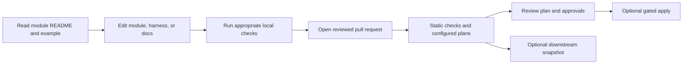

# Repository Map and Glossary

This guide is for a first visit to the repository. It explains what the repository is for, where to find common information, and the terms used in Terraform and the delivery pipelines.

## What this repository is

This is a reusable catalog of Azure Terraform modules, with examples, tests, and a root-level composition and validation harness. The root configuration helps validate and plan selected module combinations. It is not one permanently deployed Azure environment. A downstream configuration can consume a module without deploying the entire catalog.

Before making a change, identify whether you are changing a reusable module, the root harness, a pipeline, or documentation. Each has a different validation path.

## Folder map

| Path | What you will find |
| --- | --- |
| `modules/<name>/` | A reusable capability, its variables and outputs, examples, tests, and module README. |
| `main.tf`, `variables.tf`, `locals.tf`, `data.tf` | Root harness wiring, inputs, normalization, and data lookups. |
| `terraform.tfvars` | Example root settings and inputs. Treat these as examples; never put live credentials here. |
| `environments/<name>/backend.hcl` | Terraform remote-state backend settings. `prod/backend.hcl` is a placeholder and is not ready for use. |
| `tests/` | Root harness tests. |
| `docs/` | Architecture, module, deployment, pipeline, operations, security, and validation guides. |
| `.github/workflows/` | GitHub Actions pipelines for Terraform and documentation publishing. |
| `azure-pipelines.yml`, `templates/`, `scripts/azure-pipelines/` | Azure DevOps pipeline stages, shared templates, and helper scripts. |
| `scripts/` | Validation, release, documentation, and repository synchronization helpers. |

Start with the [Modules Index](../20-repository/modules-index.md) to find a capability. Read that module's README and examples before changing it. The [Module Usage and Dependencies](../20-repository/module-usage-and-dependencies.md) guide describes ordering and shared prerequisites.

## A change through the repository

The workflow configuration describes available checks and gates. Actual plans, applies, and publishing depend on repository settings, credentials, backend readiness, approvals, and pipeline capacity. A green documentation or validation workflow does not prove that Azure is deployed or healthy.

## Glossary

| Term | Plain-language meaning |
| --- | --- |
| **Terraform module** | A reusable package of infrastructure configuration with inputs and outputs. |
| **Root harness** | The root Terraform configuration that selects modules for validation or composition plans. |
| **Provider** | Terraform's connection to an API such as Azure Resource Manager. Callers configure providers and credentials. |
| **Backend** | The storage location Terraform uses for shared state and locking. |
| **State** | Terraform's record of the resources it manages. It can contain sensitive infrastructure data. |
| **Plan** | A preview of the changes Terraform proposes. Review it before applying. |
| **Apply** | The operation that makes the changes in the plan against the target environment. |
| **Variable / input** | A value supplied to a module or root configuration. |
| **Output** | A value a module exposes for callers, often a resource ID used by a dependent module. |
| **Environment** | A separately governed deployment target such as dev, sandbox, or prod. In this repo, GitHub environments and Azure DevOps variables are separate configuration surfaces. |
| **PAT** | A personal access token used to authenticate to a service. Use only the destination-specific token documented by the pipeline; never put token values in source files. |
| **PR** | A pull request: a reviewable proposal to merge a change into a protected branch. |

## Where to go next

- [First Change Walkthrough](first-change.md)
- [Stakeholder Reading Guide](stakeholder-guide.md)
- [Repository Architecture](../10-architecture/repository-architecture.md)
- [Environment and Deployment Lifecycle](../30-deployment/environment-lifecycle.md)
- [Terraform State and Recovery](../50-operations/terraform-state-and-recovery.md)
