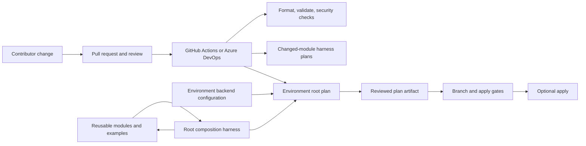

# Repository Architecture

This repository is a Terraform module catalog with a root composition and validation harness. It is not, by itself, a permanently deployed Azure environment. Downstream teams can consume modules independently; root wiring exists to validate selected combinations and support controlled plans.

## Main paths

`modules/` contains independently consumable Azure capabilities. Each module owns its Terraform resource declarations, inputs, outputs, examples, and focused tests. `main.tf`, `variables.tf`, `locals.tf`, and `terraform.tfvars` at the repository root compose selected modules and provide a common plan target. The root harness does not replace module-level ownership or make every catalog module part of one deployment.

## Dependency and ownership model

Deploy prerequisites before dependents, passing resource IDs through outputs. Typical layers are:

1. Governance and foundations: management groups, subscriptions, resource groups, policy, identities, and shared roles.
2. Shared platform: network, DNS, private connectivity, monitoring, Key Vault, and shared runtime services.
3. Workloads: compute, application, data, and AI services.

A module generally expects the caller to configure providers, credentials, target subscriptions, and shared dependencies. It only creates resources described by its own README. Check the [module dependency guide](../20-repository/module-usage-and-dependencies.md) and module README before composing resources. Provider aliases are configured by the caller; do not infer a target subscription solely from an alias name.

## Environments and state

| Environment | Backend file | Readiness |
| --- | --- | --- |
| `dev` | `environments/dev/backend.hcl` | Values are populated; validate access and backend safeguards before use. |
| `sandbox` | `environments/sandbox/backend.hcl` | Values are populated; validate access and backend safeguards before use. |
| `prod` | `environments/prod/backend.hcl` | Placeholder tenant, subscription, resource group, and storage account values. Not ready for initialization or use. |

See [Terraform State and Recovery](../50-operations/terraform-state-and-recovery.md) before using a backend. State contains sensitive infrastructure metadata and must be protected.

## Delivery and controls

GitHub Actions and Azure DevOps define validation and plan workflows. Azure DevOps currently triggers on `main` and declares `pr: none`; applies require explicit gates and reuse the published plan artifact. CI behavior depends on repository variables, credentials, branch/environment protections, backend access, and agent capacity. A configured pipeline is not evidence of a successful deployment. See [Azure DevOps Pipeline](../40-pipelines/azure-devops-pipeline.md), [GitHub Actions Pipeline](../40-pipelines/github-actions-pipeline.md), and [DevSecOps and GitOps Controls](../60-security-governance/devsecops-gitops.md).
