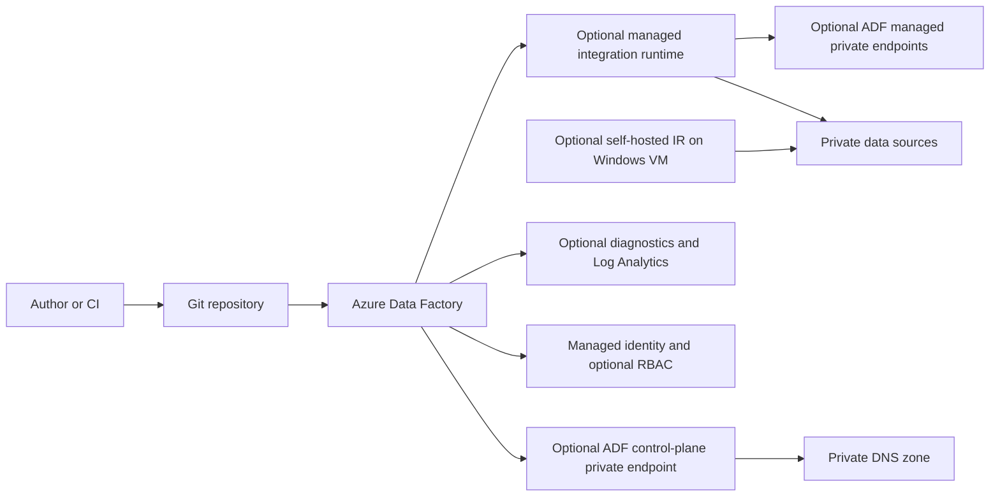

# Data Factory Architecture

The module always creates the Data Factory. Git integration, managed networking, runtimes, managed private endpoints, control-plane private endpoint, diagnostics, Key Vault integration, customer-managed key, Purview linkage, role assignments, and the Windows SHIR composition are optional. The control-plane private endpoint provides private access to the factory endpoint; managed private endpoints are separate connections used by a managed integration runtime to reach data sources.

The caller supplies the resource group, providers, and referenced networks, DNS zones, data stores, monitoring workspace, Key Vault, identities, and Purview resources. Review the [module README](../README.md) and examples for feature-specific inputs and permissions.
