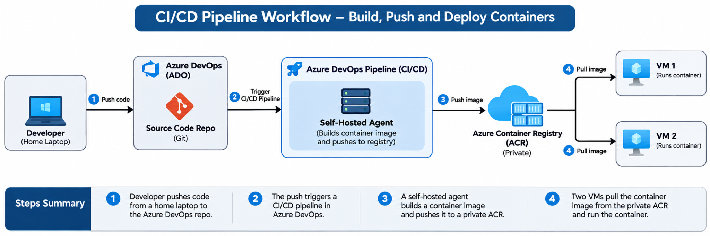
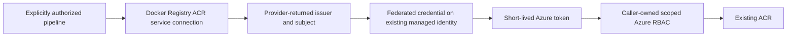

# Architecture and lifecycle

## Pipeline Workflow

The Docker Registry service connection is used by the authorized build pipeline when the self-hosted agent authenticates to ACR and pushes the image (step 3). Its federated managed identity needs caller-owned registry push permissions. The VM image pulls (step 4) use separate runtime identities and pull permissions; they do not use the Azure DevOps service connection. Agents and VMs need network and DNS access to the private registry.

The diagram shows a consuming application pipeline. This module creates only the service connection, federated trust and explicit pipeline authorizations; the repository, pipeline, agent, registry, VMs and deployment orchestration are configured separately.

## Service connection trust flow

Provision the identity independently, then the endpoint and its federated trust, then pipeline authorization. This avoids a dependency cycle with identity creation. The module passes Azure DevOps trust values directly to AzureRM, accommodating issuer changes without constructing organization/project-based subjects. The bootstrap runner must authenticate independently of the connection being created.

Keep these modules in a dedicated bootstrap root/state: they administer the CI platform and are deliberately outside the repository's Azure workload root harness. Their standalone examples and mocked tests validate them without adding Azure DevOps credentials or a provider to every workload consumer.

Changes to endpoint names, projects or identities can alter trust and interrupt jobs. Use distinct credential names for parallel migration, validate a nonproduction pipeline, update task references, then retire old trust and privileges. Never manage the same credential or authorization from both this module and another state. Deleting the connection does not revoke other credentials or role assignments on a reused identity.

Apply production service connection checks before granting pipeline access. Review endpoint administrators and manual/inherited grants periodically. Audit Azure DevOps endpoint changes and Azure managed identity credential changes through organization/Azure diagnostic policies. Retain audit records according to policy; this module does not create logging infrastructure.

## Example lifecycle and credential naming

The complete example establishes its caller-owned role assignment before invoking the connection module. Provision initially with no pipeline IDs, configure connection checks separately, then authorize specific pipelines in a second reviewed apply. Azure RBAC propagation is not an explicit Terraform readiness signal; validate the actual workload task after propagation.

When no explicit credential name is supplied, the module prefixes a deterministic hash of project ID and connection name with its endpoint type. This avoids the original shared-default collision on one identity. A project/name change can replace trust; retain an explicit existing credential name during upgrades when replacement is not intended. The example outputs expose the effective name for review. See the README's credential naming upgrade guidance before adopting the generated default for an existing connection.
