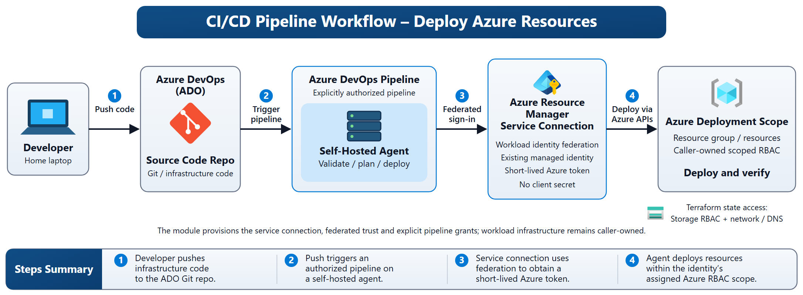

# Architecture and lifecycle

## Pipeline Workflow

[Editable SVG diagram](images/pipeline-workflow.svg).

A code push triggers an explicitly authorized pipeline on a self-hosted agent. The deployment task uses the Azure Resource Manager service connection, which exchanges its workload identity token through the federated trust on the existing managed identity. The resulting short-lived Azure token permits deployment only within the identity’s caller-owned Azure RBAC scope. For AzureCLI@2, set azureSubscription to the connection output name; a Terraform task must support workload federation and separately configure provider and backend authentication.

The diagram shows a consuming deployment pipeline. This module creates only the service connection, federated trust and explicit pipeline authorizations. The pipeline, agent, deployment resources and Terraform state storage remain separately managed. Terraform state access also needs storage data-plane permissions and network/DNS reachability. Configure connection checks before authorizing pipelines.

## Service connection trust flow

Provision the identity independently, then the endpoint and its federated trust, then pipeline authorization. This avoids a dependency cycle with identity creation. The module passes Azure DevOps trust values directly to AzureRM, accommodating issuer changes without constructing organization/project-based subjects. The bootstrap runner must authenticate independently of the connection being created.

Keep these modules in a dedicated bootstrap root/state: they administer the CI platform and are deliberately outside the repository's Azure workload root harness. Their standalone examples and mocked tests validate them without adding Azure DevOps credentials or a provider to every workload consumer.

Changes to endpoint names, projects or identities can alter trust and interrupt jobs. Use distinct credential names for parallel migration, validate a nonproduction pipeline, update task references, then retire old trust and privileges. Never manage the same credential or authorization from both this module and another state. Deleting the connection does not revoke other credentials or role assignments on a reused identity.

Apply production service connection checks before granting pipeline access. Review endpoint administrators and manual/inherited grants periodically. Audit Azure DevOps endpoint changes and Azure managed identity credential changes through organization/Azure diagnostic policies. Retain audit records according to policy; this module does not create logging infrastructure.

## Example lifecycle and credential naming

The complete example establishes its caller-owned role assignment before invoking the connection module. Provision initially with no pipeline IDs, configure connection checks separately, then authorize specific pipelines in a second reviewed apply. Azure RBAC propagation is not an explicit Terraform readiness signal; validate the actual workload task after propagation.

When no explicit credential name is supplied, the module prefixes a deterministic hash of project ID and connection name with its endpoint type. This avoids the original shared-default collision on one identity. A project/name change can replace trust; retain an explicit existing credential name during upgrades when replacement is not intended. The example outputs expose the effective name for review. See the README's credential naming upgrade guidance before adopting the generated default for an existing connection.
