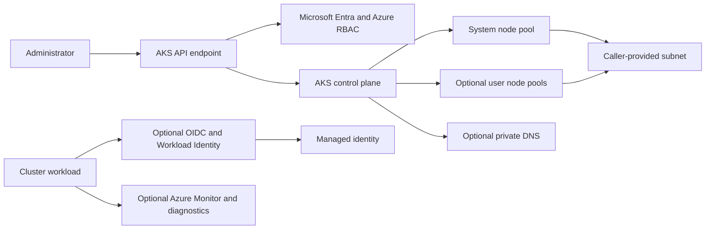

# AKS Architecture

The module creates the AKS cluster and optional additional node pools, diagnostics, and role assignments. Private API access, DNS mode, node pools, autoscaling, CNI Overlay/Cilium, workload identity, CSI/KMS, ingress, Defender, and monitoring are selected through inputs. AKS also manages a separate node resource group.

The caller owns the resource group, network/subnet sizing, optional DNS and identities, monitoring destinations, and any ingress or key-management dependencies. Review cluster access separately from workload identity permissions. See the [module README](../README.md) and [kubelogin guide](../../../docs/30-deployment/aks-authentication-kubelogin.md).
