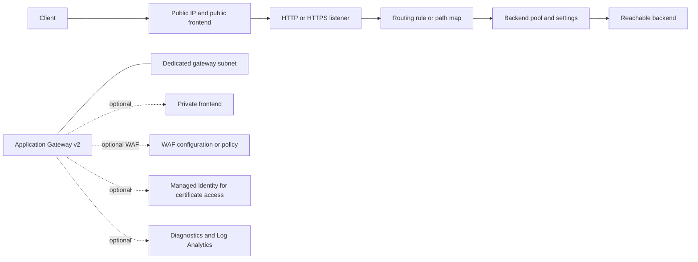

# Application Gateway Architecture

The module always creates an Application Gateway v2 and a Standard static public IP. A private frontend is additional; it does not replace the public frontend. The caller supplies the resource group, dedicated gateway subnet, reachable backends, and any WAF policy, identity, or Log Analytics workspace. HTTPS certificate PFX data and passwords can enter Terraform state, so protect state and plan artifacts. See the [module README](../README.md).
