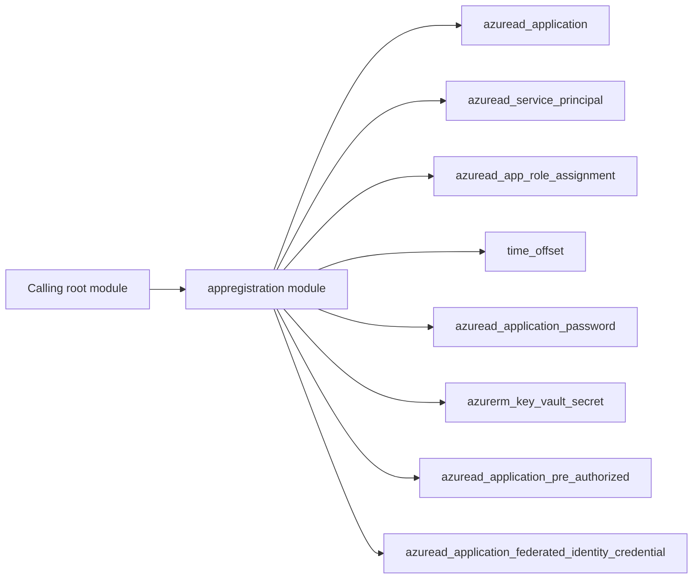

# Microsoft Entra Application Registration Architecture

The appregistration module declares 8 managed resource type(s), including `azuread_application`, `azuread_service_principal`, `azuread_app_role_assignment`, `time_offset`, `azuread_application_password`, `azurerm_key_vault_secret`, `azuread_application_pre_authorized`, `azuread_application_federated_identity_credential`.

Resources that use `count` or `for_each` are gated by inputs such as `feature_tags`, `spa_redirect_uris`, `public_client_redirect_uris`, `create_service_principal`, `create_client_secret`, `key_vault_id`. Review those inputs to see which optional components a deployment creates.

The module accepts 50 input(s), with 0 required.
It returns 17 output(s), including `application_object_id`, `application_id`, `display_name`, `publisher_domain`, `service_principal_object_id`, `service_principal_id`. Pass these to downstream modules instead of recreating the resources in the caller.

The caller owns the surrounding infrastructure, such as the resource group, networks, identities, and key or log destinations that this module references. See the [module README](../README.md) for inputs and usage.
