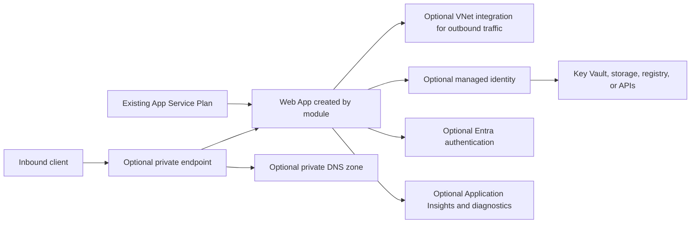

# App Service Architecture

The module creates one Linux or Windows Web App and selected optional resources. The App Service Plan is an existing dependency. VNet integration supports outbound access; a private endpoint and DNS handle private inbound access. These are separate network paths. The module does not grant downstream identity permissions merely by attaching an identity. The caller provides the resource group, plan, delegated subnet, private endpoint subnet/DNS, and dependency resources. See the [module README](../README.md).
