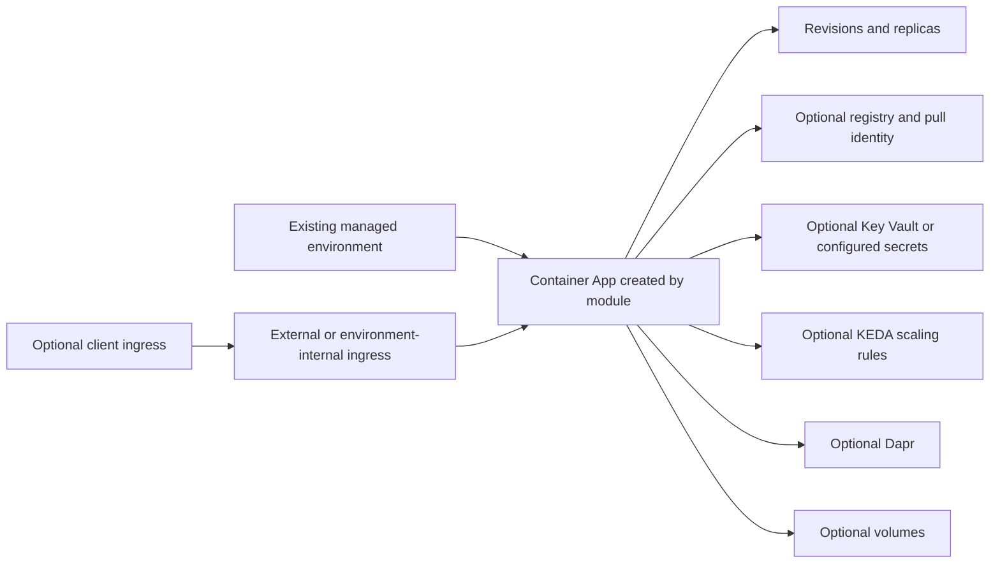

# Container App Architecture

The module creates one Container App in a caller-owned managed environment. It configures container definitions, revision mode and traffic, optional ingress, identity, secret references, registries, volumes, Dapr, and scaling. Ingress is not created unless enabled. The environment, network, logging, registries, Key Vault, identities, and storage remain caller-owned dependencies. Inline secret values may be stored in Terraform state; prefer protected references and pin production images to immutable versions. See the [module README](../README.md).
