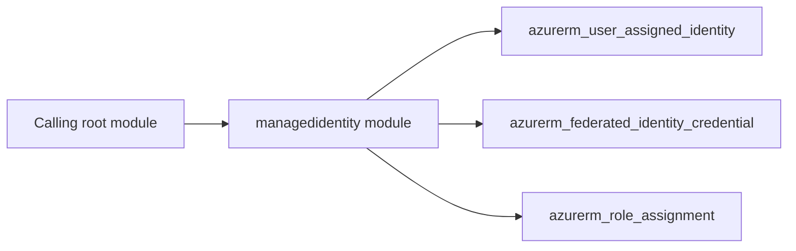

# Azure User-Assigned Managed Identity Architecture

The managedidentity module declares 3 managed resource type(s), including `azurerm_user_assigned_identity`, `azurerm_federated_identity_credential`, `azurerm_role_assignment`.

Resources that use `count` or `for_each` are gated by inputs such as `inherit_resource_group_tags`, `inherited_resource_group_tags`, `federated_identity_credentials`, `role_assignments`. Review those inputs to see which optional components a deployment creates.

The module accepts 11 input(s), with 2 required.
It returns 10 output(s), including `id`, `name`, `client_id`, `principal_id`, `tenant_id`, `federated_identity_credential_ids`. Pass these to downstream modules instead of recreating the resources in the caller.

The caller owns the surrounding infrastructure, such as the resource group, networks, identities, and key or log destinations that this module references. See the [module README](../README.md) for inputs and usage.
