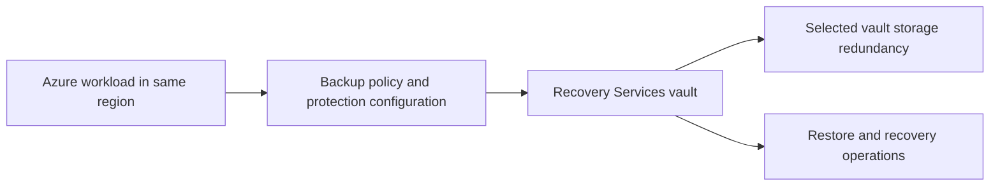

# Recovery Services vault architecture

The module creates one `azurerm_recovery_services_vault` in a caller-provided resource group and region. Azure Backup stores recovery points in the vault; separate backup policy and protection resources define what is backed up and how long recovery points are retained.

## Design boundaries

- The caller owns the resource group and provider configuration.
- The module does not create backup policies, protected items, private endpoints, diagnostic settings, or role assignments.
- Select vault redundancy before onboarding protected data. Cross-region restore requires geo-redundant storage.
- Public network access defaults to enabled for broad workload compatibility. Disable it only after supported private endpoint connectivity and DNS have been configured.
- Immutability defaults to `Unlocked`. Review retention and deletion workflows before enabling `Locked`, because locking is irreversible.

See [Microsoft's Recovery Services vault configuration guidance](https://learn.microsoft.com/azure/backup/backup-create-recovery-services-vault) and [Azure Backup security guidance](https://learn.microsoft.com/azure/backup/secure-backup) before deploying production protection.
